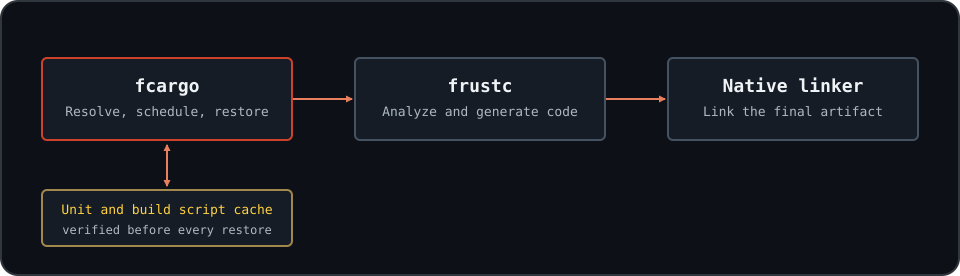

**A Rust compiler and Cargo toolchain built for faster rebuilds.**

[Architecture](docs/how-it-works.md) · [Configuration](docs/configuration.md) · [Benchmarks](docs/benchmarks.md) · [Contributing](CONTRIBUTING.md)

This branch packages a Rust 1.100.0 stage-2 toolchain with a patched Cargo (`frustc`, `fcargo`, and rustdoc). Two measured compiler changes missed the frozen release-build budgets. Those probes are recorded in `qualification/CANDIDATE.md`. A faster rebuild on meaningful full-LTO edits remains unqualified. Host compatibility for this package is recorded in `qualification/COMPAT.md`.

| Area | Design target |
| --- | --- |
| Compatibility | Build existing Rust projects and crates with the language, standard library and Cargo behavior of a matched upstream Rust release. |
| Incremental builds | Track dependencies inside the compiler so a localized edit can reuse unaffected analysis and code generation. |
| Release builds | Shorten release build times while preserving full LTO when requested. Measure executable speed and size against matched upstream builds. |
| Central storage | Keep build outputs and reusable compiler state under user-configurable central directories by default. |

## Toolchain

fRust is designed to ship its own `frustc` compiler, matching standard library and `fcargo`. Linux x86-64 and Apple Silicon macOS are the first planned host platforms. Distributions will use standalone toolchain archives for those hosts.

## Project history

The [changelog](CHANGELOG.md) records the earlier fRust build accelerator and the transition to the compiler project. See [reporting guidance](SECURITY.md) for security issues.
