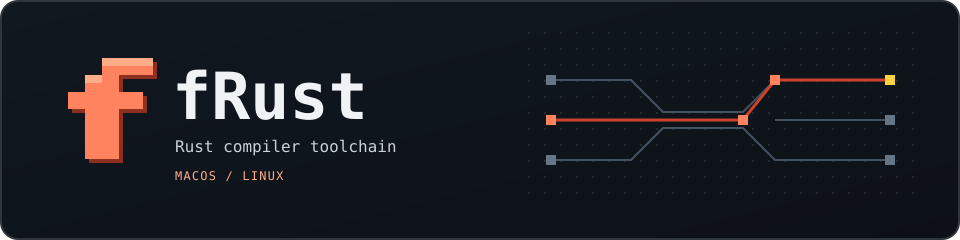

<div align="center">



**A Rust toolchain built from pinned upstream sources, with a Cargo that reuses verified work.**

[Architecture](docs/how-it-works.md) · [Configuration](docs/configuration.md) · [Benchmarks](docs/benchmarks.md) · [Contributing](CONTRIBUTING.md)


</div>

## Status

fRust packages Rust 1.100.0 (upstream commit `0ef1bc386`, pinned in `support/upstream.lock`) built from source with a patched Cargo, `fcargo`, `frustc` and rustdoc. Its compiler, standard library and LLVM are the upstream sources apart from one experimental object-reuse patch that is off by default; the changes that matter are in Cargo, in the central target layout, and in how finished work is reused.

Published performance numbers come from the [Benchmark workflow](.github/workflows/benchmark.yml) on GitHub-hosted runners and are recorded in [the benchmark page](docs/benchmarks.md). Dated development measurements from a local host are kept in [the qualification notes](qualification/OPTIMIZED-LINUX.md) and are not release claims.

The release workflow builds the toolchain on GitHub-hosted runners without profile-guided or BOLT optimization of the compiler, so it measures against a control built the same way and makes no claim against the official rustup toolchains. Linux x86-64 is the host with test evidence. macOS and aarch64 Linux toolchains are built by the same workflow and have only the workflow's launch check. Windows is not supported.

## Install

```sh
cargo install --git https://github.com/Seggys116/frust frust-rs --bin frust-install
frust-install install
export PATH="$HOME/.local/share/frust/current/bin:$PATH"   # macOS: ~/Library/Application Support/fRust/current/bin
fcargo build
```

`frust-install` verifies the sha-256 file before extracting, keeps the previous version, and supports `update`, `rollback` and `uninstall`. Linux x86-64 is the only published target. The prefix defaults to `$FRUST_PREFIX`, then `$XDG_DATA_HOME/frust` or `~/.local/share/frust`.

## What it changes

- **Unit and build script cache.** Under `fcargo`, finished rustc outputs of registry, git and directory-source libraries and proc-macros, and heavy build script runs, are stored in a content-addressed store and restored after verification. Any mismatch compiles normally. Path and workspace members, incremental units and wrapper builds are never cached. See [how it works](docs/how-it-works.md#unit-artifact-cache) and [configuration](docs/configuration.md#unit-artifact-cache).
- **Faster startup.** libgit2 starts on first git use instead of on every Cargo invocation, and `fcargo` is the patched Cargo itself on Linux, so a plain invocation skips a process launch.
- **Central targets.** Build outputs go under a per-user target root, namespaced by toolchain and workspace, with every explicit Cargo override preserved. A JSON file sets the roots. Superseded executables of managed targets are cleaned up by default.
- **Native fat-LTO defaults.** On Linux x86-64, release builds that select fat LTO use incremental compilation and 16 codegen units when the project leaves them open. See [configuration](docs/configuration.md#native-fat-lto-defaults) and [the measured tradeoff](qualification/SEMANTIC-LTO.md#incremental-fat-lto-profile).

Compiler candidates that were measured and not kept are under `support/patches/rustc/` and in [the candidate notes](qualification/CANDIDATE.md).

## Toolchain

The toolchain ships `frustc` (a hardlink to `rustc`), `fcargo` (a hardlink to the patched `cargo`), `fcargo-ui`, `cargo` and rustdoc. `fcargo` hands over to `fcargo-ui` to draw build progress on a terminal, for static progress, for an explicit `FRUST_CARGO` and for `+toolchain`. `frust-gates` recomputes the frozen budgets from raw paired samples.

<p align="center"></p>

## Project history

The [changelog](CHANGELOG.md) records the earlier fRust build accelerator (the 0.4.x line, kept on the `legacy-0.4` branch) and the transition to the compiler project. See [reporting guidance](SECURITY.md) for security issues.
