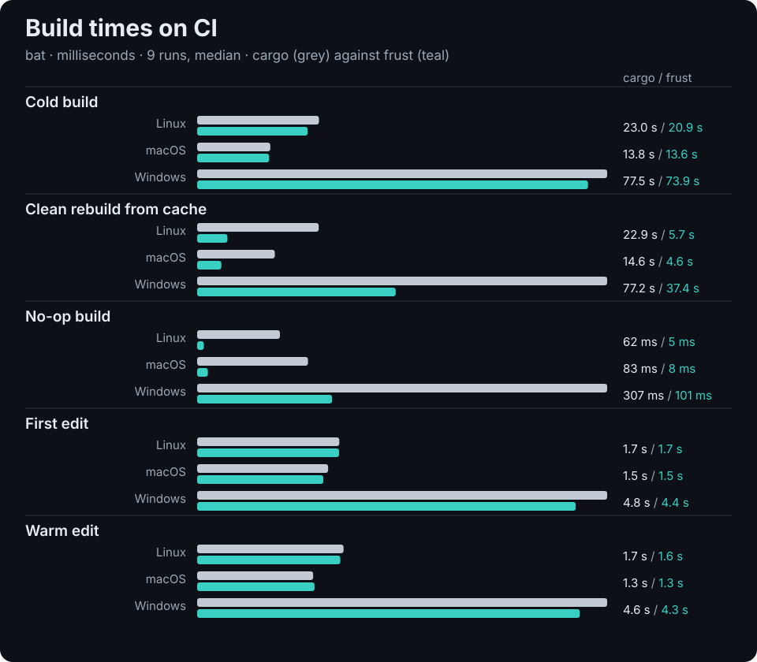
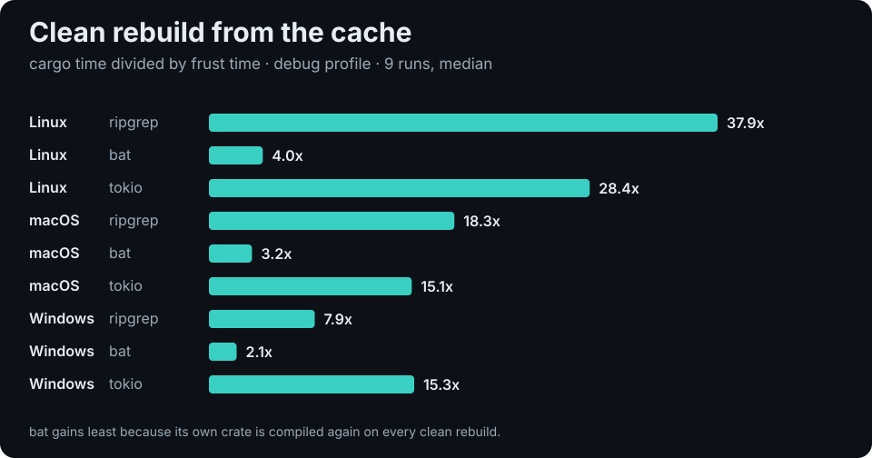
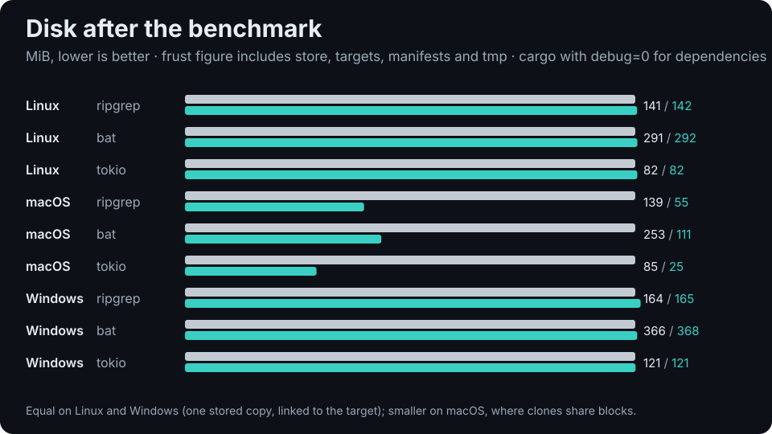
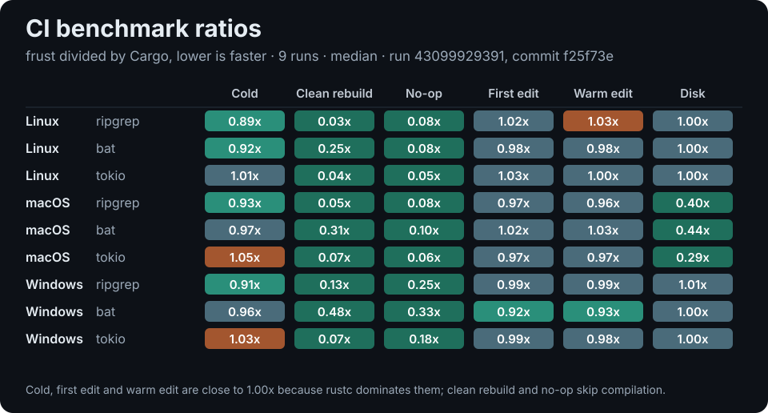

<div align="center">



**A thin accelerator that sits on top of the Rust toolchain you already have.**

[](https://github.com/Seggys116/frust/actions/workflows/ci.yml)
[](https://github.com/Seggys116/frust/blob/main/LICENSE)
[](https://www.rust-lang.org)


[Install](#install) · [How it works](#how-it-works) · [Use](#use) · [Builds that overlap](#builds-that-overlap) · [Results](#results) · [Docs](https://github.com/Seggys116/frust/blob/main/docs/how-it-works.md)


</div>

<br>

> frust does not ship a compiler, patch cargo or re-implement its command line. It asks your installed `cargo` and
> `rustc` what they are, then wraps them. Every argument, `+toolchain`, stdout, stderr and exit code passes through.

<table>
<tr>
<td width="25%" valign="top"><b>Compile cache</b><br><sub>Shared across projects and clean rebuilds. A hit restores the exact outputs without starting rustc, as a copy-on-write clone where the filesystem supports it.</sub></td>
<td width="25%" valign="top"><b>Central targets</b><br><sub>One directory per workspace and toolchain. Projects stay clean and switching toolchains never invalidates the others.</sub></td>
<td width="25%" valign="top"><b>Build locks</b><br><sub>A fair queue in front of cargo's own. Identical concurrent builds share one build, and waiters see who holds the lock.</sub></td>
<td width="25%" valign="top"><b>Clean display</b><br><sub>Colour, live progress, cache counters and terminal integration. Plain cargo output when piped.</sub></td>
</tr>
</table>

## How it works

You run `fcargo`. frust takes the build lock, points cargo at a central target directory and starts your own cargo, which
runs `frust-wrap` in place of rustc for each crate. A cache hit restores the stored outputs without starting the compiler.

<p align="center"></p>

<p align="center"></p>

## Install

**macOS and Linux**

```sh
curl -fsSL https://raw.githubusercontent.com/Seggys116/frust/main/install.sh | sh
```

**Windows (PowerShell)**

```powershell
irm https://raw.githubusercontent.com/Seggys116/frust/main/install.ps1 | iex
```

**Anywhere with Rust**

```sh
cargo binstall frust-rs   # prebuilt binaries
cargo install frust-rs    # from source
```

Binaries are checksummed and installed to `~/.local/bin` (`%LOCALAPPDATA%\frust\bin` on Windows). Run `frust doctor`
afterwards to check your setup. The crates.io package is `frust-rs` because the name `frust` belongs to an unrelated crate.

Windows support is new. The test suite runs on Windows in CI, but it has had far less real-world use than macOS and Linux.

<p align="center"></p>

## Use

Use `fcargo` wherever you would use `cargo`:

```sh
fcargo build --release
fcargo +nightly test -p mycrate -- --nocapture
fclippy --all-targets
```

| Command | Purpose |
|---|---|
| `frust stats` | Hit rate, time saved, cache and target sizes |
| `frust doctor` | Check the environment frust relies on |
| `frust locks` | Show running and queued builds |
| `frust compact` / `frust gc` | Shrink target directories and prune the cache |
| `frust env` | Print shell exports so IDEs and rust-analyzer share the cache |
| `frust where` | Print the central target directory for this workspace (`frust where check` prints the one `check` and `clippy` use) |

Anything frust does not recognise is passed straight to cargo. Set `FRUST_BYPASS=1` to run cargo completely untouched.

On macOS, `FRUST_LINK=smart fcargo build` opts eligible dev binaries into the direct native-linker path. Measure actual edit builds with `frust bench --linking --runs 7`; see [configuration](docs/configuration.md) for eligibility and controls.

## Builds that overlap

<p align="center"></p>

Builds in different profiles run in parallel. Builds in the same profile queue in order, and an identical build joins the
one already running instead of waiting. A `--target` build also takes its profile's host slot, so it queues behind other
builds of that profile.

<p align="center"></p>

## Results

<p align="center"></p>

Measured by the Bench workflow on GitHub-hosted Linux, macOS and Windows runners against ripgrep, bat and tokio, nine runs per phase. Clean rebuilds from the cache were **2.1× to 37.9× faster** and no-op builds **3.0× to 19.5× faster**; the whole frust home was **56% to 71% smaller** than cargo's target on macOS and equal elsewhere. Cold builds and edits are bound by rustc, so they tie cargo within a few percent. [Method and results](docs/benchmarks.md#latest-ci-results).

<p align="center"></p>

<p align="center"></p>

<p align="center"></p>

<p align="center"></p>

## Updating

After a successful build on an interactive terminal, frust prints a one-line notice when a newer release exists. Run
`frust self-update` to install it; the command verifies the download's SHA-256 before replacing anything. It is not
`frust update`, so `cargo update` keeps working. Set `FRUST_UPDATE_CHECK=off` (or run `frust self-update --disable`)
to stop the daily check.

<p align="center"></p>

## Learn more

[How it works](https://github.com/Seggys116/frust/blob/main/docs/how-it-works.md) &middot; [Configuration](https://github.com/Seggys116/frust/blob/main/docs/configuration.md) &middot; [Benchmarks](https://github.com/Seggys116/frust/blob/main/docs/benchmarks.md) &middot; [Contributing](https://github.com/Seggys116/frust/blob/main/CONTRIBUTING.md) &middot; [Security](https://github.com/Seggys116/frust/blob/main/SECURITY.md) &middot; [Changelog](https://github.com/Seggys116/frust/blob/main/CHANGELOG.md)

<br>

<p align="center"><sub>MIT licensed &middot; &copy; 2026 Zak Noble-Clarke</sub></p>

<div align="center">

<a href="https://www.buymeacoffee.com/seggy116"></a>

</div>
