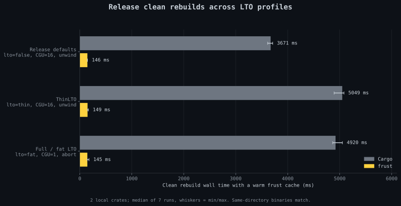
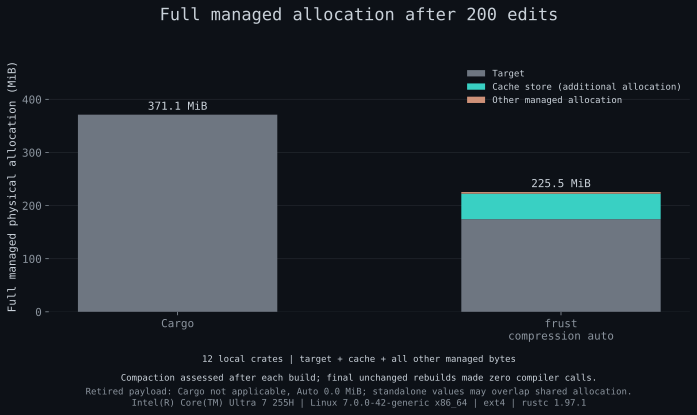

# Benchmarks

## Method

The measurements use release binaries built from the Rust sources in [321931e](https://github.com/Seggys116/frust/commit/321931ee0ebeaa02cd3177c18f12e5f002c56d17).

Times are milliseconds, median [minimum, maximum] across seven repetitions unless stated otherwise. Observed ranges describe these runs; no confidence interval or runtime-throughput claim is inferred. Cold means an empty build target and frust cache, with the toolchain and registry dependencies already installed; the OS page cache was not cleared. The general graph has four local crates plus registry dependencies; the release-profile graph has two local crates plus registry dependencies.

Build latency uses production deferred stores and automatic compression. Foreground wall time includes the frontend, Cargo and compiler audit. Store completion is measured separately: after child exit, the observer waits for no job files and holds every existing slot lock exclusively together. Settled time runs from child start through that proof; drain is the observed interval outside foreground. These observations establish completion coverage, not helper counts or fallback frequency. Growth uses synchronous stores and assesses automatic compaction after every build. Source-stamp settling and allocation inspection are outside growth build latency.

Latency-suite edits change executable function bodies and check program output. Growth replays body/signature edits, feature changes and reverts across bottom, middle and application crates. A clean restore and the first subsequent edit are separate from an edit in a warm incremental session. Release comparisons keep each profile’s Cargo/rustc flags identical between tools: defaults use LTO=false, 16 codegen units, unwind; ThinLTO uses LTO=thin, 16 codegen units, unwind; full/fat LTO uses LTO=fat, one codegen unit, abort. All three have incremental=false. Cargo’s lto=false permits thin local LTO; it differs from lto="off". Same-path binaries match exactly between tools and across clean restores; measured binaries are executed.

The audit retains every backend rustc call. Known inspection-only print requests and version/help calls are counted separately from Cargo unit compilations and build-script capability probes. An allowlist with option-operand parsing identifies queries; compilation-bearing, malformed and unknown --print requests remain outside that query class. Queries and probes contribute to measured wall time. No-op checks require zero backend calls of every class, zero Cargo compilation notices and zero cache hits/misses.

Concurrent cold groups are a separate workload: two equivalent dev-inherited profiles (`coldone`, `coldtwo`) build the same two-local-library plus registry graph concurrently into separate targets. At each group start, both targets and the shared cache are empty except independently warmed compiler-info memos for each tool/profile cell. Groups alternate Cargo/frust order and profile spawn order; there is no artificial compiler gate. The group clock starts before the first spawn and stops after both direct foreground processes exit; actual spawn skew is recorded. One shared-home drain precedes settled completion. This proves store completion, without asserting that every descendant exited. Intra-group peer cache hits are expected; a concurrent-group improvement does not establish an isolated cold-build improvement. Compiler instrumentation is shared between arms and can affect scheduling. Raw source/tool hashes and fresh-cohort provenance bind the reports to the recorded binaries and original toolchain.

The fresh measurement cohort records each command, capture interval, report digest, frozen frontend/wrapper identities, original compiler and Cargo versions, native compiler identity, sysroot identity and hardware/filesystem context. Missing in-report metadata, including growth hardware/store policy, comes from this contemporaneous runner provenance; it is not inferred from earlier results. Raw reports and the cohort manifest remain outside the repository.

Reproduce with the same release-built frust binary and at least 12 GiB free. Set TMPDIR to an existing scratch directory on the filesystem being measured. The general command includes the release-profile matrix. The standalone --profiles command below is an optional separate rerun. Raw JSON reports can remain under /tmp independently of the fixture TMPDIR; keep them outside the repository:

```bash
export TMPDIR=/path/to/scratch-on-measured-filesystem
frust bench --quick --runs 7 --store=deferred --compression=auto --json > /tmp/frust-builds.json
# Optional: rerun only the profile matrix already included above.
frust bench --profiles --quick --runs 7 --store=deferred --compression=auto --json > /tmp/frust-profiles.json
frust bench --growth --edits=200 --every=20 --libs=12 --variants=cargo,auto --compression=auto --json > /tmp/frust-growth.json
frust bench --growth --settle-edits --edits=200 --every=20 --libs=12 --variants=cargo,auto --compression=auto --json > /tmp/frust-growth-settled.json
frust bench --linking --quick --runs 7 --json > /tmp/frust-linking.json
frust bench --concurrent --quick --runs 7 --store=deferred --compression=auto --json > /tmp/frust-concurrent.json
```

## Results

Measured on 2026-11-01 using Intel(R) Core(TM) Ultra 7 255H (16 logical CPUs), Linux 7.0.0-42-generic x86_64, ext4, rustc 1.97.1. General-suite load before/after: 0.20/2.32; profile-suite load: 3.10/1.87; immediate-growth load: 2.32/2.97; settled-growth load: 2.97/3.47; linker-suite load: 3.47/3.27. Concurrent-suite load: 3.27/4.69; Cargo 1.97.1 (c980f4866 2026-06-30); concurrent compiler identity matches the profile suite. Reflinks supported: false.

### Debug builds



| Operation | Cargo ms | frust ms |
| --- | --- | --- |
| Cold | 3271 [2780, 3488] | 3594 [2963, 3858] |
| Second project | 3394 [2787, 3612] | 818 [696, 862] |
| Clean rebuild / restore | 3426 [2782, 3560] | 169 [161, 189] |
| No-op | 18 [17, 19] | 20 [19, 22] |
| First edit after restore | 89 [84, 94] | 95 [90, 96] |
| Warm-session edit | 87 [80, 99] | 96 [95, 101] |

### Concurrent cold groups

Each sample completes **two concurrent builds**, with intra-group peer reuse starting from an empty shared cache. These group totals are distinct from the single-build cold rows above. Differences below use matching repetition pairs (frust minus Cargo); their median need not equal the difference between tool medians.

| Measurement | Cargo ms | frust ms | Paired difference ms | frust faster pairs |
| --- | --- | --- | --- | --- |
| Foreground group | 4916.596 [4516.652, 5092.388] | 3676.050 [3388.185, 4335.736] | -1174.257 [-1496.962, -748.822] | 7/7 |
| Settled group | 4916.630 [4516.686, 5092.451] | 3676.321 [3388.271, 4335.814] | -1174.212 [-1496.941, -748.793] | 7/7 |

Observed Cargo-unit compilation totals across the seven Cargo/frust pairs were 40→20, 40→20, 40→20, 40→20, 40→20, 40→20, 40→20. Each pair proved 14 uniquely identified shared units compiled once with positive-byte store and peer-hit evidence. Those counts exclude separately retained inspection queries and build-script capability probes. Same-path executable bytes and runtime output matched across tools and profiles. All final unchanged groups executed zero compiler calls (including queries), zero Cargo compilation notices and zero cache events.

### Release profiles



| Profile | Operation | Cargo ms | frust ms |
| --- | --- | --- | --- |
| Defaults | Cold | 3663 [3535, 3800] | 3987 [3814, 4167] |
| Defaults | Clean rebuild / restore | 3709 [3538, 3791] | 144 [141, 152] |
| Defaults | No-op | 19 [18, 20] | 21 [20, 22] |
| Defaults | Body edit | 67 [65, 68] | 72 [70, 81] |
| ThinLTO | Cold | 5059 [4834, 5363] | 5250 [5185, 5415] |
| ThinLTO | Clean rebuild / restore | 5031 [4828, 5272] | 146 [139, 157] |
| ThinLTO | No-op | 19 [18, 27] | 21 [20, 22] |
| ThinLTO | Body edit | 1809 [1730, 1874] | 1829 [1814, 1841] |
| Full/fat LTO | Cold | 4938 [4835, 5155] | 5188 [5010, 5265] |
| Full/fat LTO | Clean rebuild / restore | 4944 [4750, 5010] | 144 [136, 153] |
| Full/fat LTO | No-op | 19 [18, 20] | 21 [20, 24] |
| Full/fat LTO | Body edit | 1675 [1630, 1740] | 1689 [1654, 1722] |

Frust retained a positive paired median isolated-cold overhead for debug, ordinary release, ThinLTO, full/fat LTO. The concurrent-group result does not remove those regressions. Cold rows above contain each tool’s own median. The following differences use matching repetition pairs (frust minus Cargo); their median need not equal the difference between tool medians. Cold pairs alternate tool order.

| Cold comparison | Paired difference ms | Paired difference % | Positive differences |
| --- | --- | --- | --- |
| Debug general graph | 183 [142, 587] | 6.6% [4.5%, 17.9%] | 7/7 |
| Defaults | 365 [151, 421] | 9.9% [4.1%, 11.6%] | 7/7 |
| ThinLTO | 198 [-175, 416] | 3.9% [-3.3%, 8.6%] | 6/7 |
| Full/fat LTO | 227 [45, 327] | 4.6% [0.9%, 6.6%] | 7/7 |

Each debug cold sample compiled 22 Cargo units and ran 3 build-script capability probes with either tool. Cargo issued 8 queries and frust 10: two extra frust cold queries, retained in total latency. Warm restores require zero Cargo-unit and unknown compilations, positive cache hits and zero misses; any inspection queries or capability probes remain visible. Debug and release no-op samples made zero compiler calls, including queries.

### Deferred store completion

All listed frust samples include the completion proof. Foreground values are in the build tables; these columns report the separate observed drain and total settled time.

| frust operation | Drain ms | Settled total ms |
| --- | --- | --- |
| Debug: cold | 20 [10, 20] | 3604 [2983, 3878] |
| Debug: second project | 20 [10, 20] | 839 [706, 883] |
| Debug: clean rebuild / restore | 0 [0, 0] | 169 [161, 189] |
| Debug: no-op | 0 [0, 0] | 20 [19, 22] |
| Debug: first edit after restore | 20 [0, 20] | 114 [90, 117] |
| Debug: warm-session edit | 20 [0, 20] | 116 [95, 122] |
| Defaults: cold | 0 [0, 0] | 3987 [3814, 4167] |
| Defaults: clean rebuild / restore | 0 [0, 0] | 144 [141, 152] |
| ThinLTO: cold | 0 [0, 0] | 5250 [5185, 5415] |
| ThinLTO: clean rebuild / restore | 0 [0, 0] | 146 [140, 158] |
| Full/fat LTO: cold | 0 [0, 0] | 5188 [5010, 5265] |
| Full/fat LTO: clean rebuild / restore | 0 [0, 0] | 144 [137, 153] |

### Managed allocation after 200 edits



Both sequences use 12 local libraries, one application and registry dependencies. Each tool completed 200 steps of body/signature edits, feature changes and reverts, produced matching output throughout, recorded 1,542 compilations including the initial build, and made zero compiler calls on the final unchanged rebuild. These are single completed growth sequences, not seven-run latency distributions. Allocation counts unique device/inode blocks across managed roots. Toolchain and Cargo registry storage are excluded. Target plus store is a subset of full managed allocation. The cache column is the additional store allocation beyond the target; other managed allocation includes controls and other managed roots. Displayed MiB values are rounded independently, so components may not sum to the displayed total. Standalone retired payload may share inodes or extents with target/store and is annotated separately, never added to a stack.

| Sequence | Tool | Target MiB | Cache (additional) MiB | Other managed MiB | Full managed MiB |
| --- | --- | --- | --- | --- | --- |
| Immediate edits | Cargo | 371.1 | 0.0 | 0.0 | 371.1 |
| Immediate edits | frust | 174.4 | 48.1 | 3.1 | 225.5 |
| Settled source stamps | Cargo | 371.1 | 0.0 | 0.0 | 371.1 |
| Settled source stamps | frust | 174.4 | 48.6 | 3.0 | 226.0 |

Settled source checks waited 20.138 seconds for Cargo, 20.225 seconds for frust outside build latency. Neither frust replay retained queued payload allocation at its endpoint; this cache-home measure is not applicable to Cargo.

The settled replay's cache evidence was captured before the final build's compaction: 21 unit records contained 63 key references, including 8 stale references without current cache entries. The maximum retained keys per unit was 3, within the configured bound of 4; the retired queue contained 0 payload entries. Allocation was measured after maintenance. The final unchanged build made zero compiler calls. Retention observations check descriptors and backing presence rather than full restore integrity.

### Native linking baseline

With FRUST_LINK=off, the configured linker is preserved and the artifact cache is off. Seven real main-function edits each compiled exactly one main binary and produced the expected edit output. Benchmark-only RUSTC_BOOTSTRAP=1 and -Ztime-passes instrument the primary application; dependencies receive no profiling flags. Total build time includes frontend and Cargo; native link time is the single current main-binary link_binary phase. This instrumentation is separate from the production build tables. Only the baseline mode was measured; no native-link reuse or transformed-linker speedup is claimed.

| Measurement | ms median [min, max] |
| --- | --- |
| Total build | 86 [82, 97] |
| Native link phase | 34 [30, 45] |
